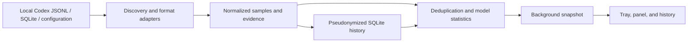

# Architecture

TokenPulse uses Python 3.11+, PySide6 Essentials (Qt Widgets), and SQLite. Measurement and persistence use the Python standard library; pyzstd supplies bounded streaming decompression of archived sessions. Qt provides native desktop entry points without an embedded browser.

## Module map

All paths below are relative to `src/token_pulse/`.

| Module | Responsibility |
| --- | --- |
| `domain.py` | Samples, context, exclusions, evidence reconciliation, task freshness |
| `tailer.py` | Bounded plain/compressed JSONL reads, partial lines, frame validation, truncation and rotation |
| `collector.py` | Source discovery, path containment, live polling and task state |
| `logs.py`, `submissions.py` | Read-only diagnostics and bounded outer submission parsing |
| `sqlite_recovery.py`, `evidence_archive.py` | Structural recovery of intact diagnostic records and bounded HMAC-only origin/retry persistence |
| `thread_settings.py` | Bounded thread-owned snapshot history, turn-start chronology and association validation |
| `transport.py`, `transport_logs.py` | Responses sequence validation, bounded SQLite transport recovery and safe cursors |
| `rollout.py` | Event normalization, usage/timing association, fork and replay detection |
| `backfill.py` | Budgeted seven-day historical recovery independent of the live task limit |
| `history.py` | Local HMAC identities, SQLite persistence, revisions, recovery records, CSV |
| `stats.py`, `timeline.py` | Deduplication, model summaries and time-window selection |
| `service.py` | Background ownership of collection/storage and snapshot publication |
| `app.py`, `ui/` | Lifecycle, tray, settings, panel, history and chart |
| `i18n.py`, `locales/` | Offline translation and in-place language refresh |

## Boundaries and invariants

The UI consumes snapshots and never parses raw logs or reads source databases. A background worker owns collection and history access. Live and stored observations share pseudonymized identities before merging.

Source adapters interpret version-dependent internal formats. The normalized model retains unknown evidence rather than guessing it. Exact statistics and exclusion rules are defined in [measurement](measurement.md); source relationships and regression rationale are in [source evidence](source-audit.md).

Thread snapshots enter the same rollout parser in live collection and historical recovery. They retain only tier/state, observation and turn-boundary times, source and association status. An exactly scoped submission independently supplies the turn override. A validated configuration fallback changes display evidence, never sample identity, tokens, timing, request values or server-confirmed tiers. Source loss preserves saved evidence; contradictory overrides remain conflicts, and transport timing replacement revalidates the snapshot boundary.

Discovery inspects required SQLite tables/columns in the source root and its historical `sqlite/` layout. It selects one compatible index and general diagnostic database. The transport reader separately checks up to eight compatible diagnostic stores; overlapping outputs merge by exact response identities or complete item aliases. Each source validates its own stream without splicing events across stores. Indexed `.jsonl` paths can resolve to compressed siblings; both spellings share a logical recovery key, while changed container metadata invalidates reuse. Decoding is sequential and in memory. Compressed byte positions are never used as decoded JSONL offsets, and thread-history offsets are not currently consumed.

Live tracking is bounded to 32 recent unarchived tasks. Separate historical recovery covers indexed sessions, including archived ones, in bounded chunks. Completed-file records are saved only after sample persistence; changed files, evidence, or recovery rules trigger re-evaluation. Pending writes are bounded and retried. See [compatibility](compatibility.md) for limits.

Diagnostic origins and sampling interruptions are archived separately from completed outputs, so a late-discovered session can use evidence observed before source rotation. The archive retains HMAC identities, timestamps, provenance and already normalized evidence only. It restores before collection and commits before source completion checkpoints. Optional SQLite recovery reads a transaction-consistent in-memory snapshot once per diagnostic database reset; only complete, structurally validated records enter the existing evidence parser. It never writes to the source database or saves raw snapshots.

Transport parsing retains identities, lifecycle metadata and ephemeral HMAC event digests rather than response content. Persistence stores pseudonymized aliases and quiescent cursors after sample writes succeed; an interrupted response replays from a prior safe boundary. Rotation/replacement, schema changes and unsupported events degrade to excluded records. A valid transport interval replaces weaker timing as a unit, while source provenance remains available. The UI and weighted aggregation consume the same normalized `Sample` objects as session recovery.

Keep platform differences in path discovery, tray/window behavior, and system integration. Statistical tests must run without live Codex accounts or network calls. Do not add a plugin framework for hypothetical future clients.

## UI design

The compact panel prioritizes the chosen model, average speed, and individual-output timeline. Channel/configuration evidence belongs in details; history and settings are secondary windows. Use color and shape together, preserve keyboard access to overlapping points, and provide explicit no-data and stale states.

The glass-inspired appearance is rendered inside the application. It does not capture the desktop or claim native Apple material behavior. Shared control surfaces avoid nested effects; short interaction animations stop when idle or hidden. Reduced transparency and reduced motion provide simpler rendering. Themes use semantic colors and system fonts, with no downloaded fonts. [Design references and attribution](../THIRD_PARTY.md#design-references) are retained separately from implementation instructions.

## Deliberate tradeoffs

- Internal logs offer local observations without changing Codex configuration, but require conservative parsing and version-specific fixtures.
- A Qt/Python app has installation and runtime costs; no memory or CPU targets are claimed without measurement.
- Chinese message keys preserve the existing offline catalog. Public code comments and documentation use English.
- The UI plots samples directly. Existing internal bucket objects also support record-detail scopes; do not remove them solely because the chart is now a scatter plot.
